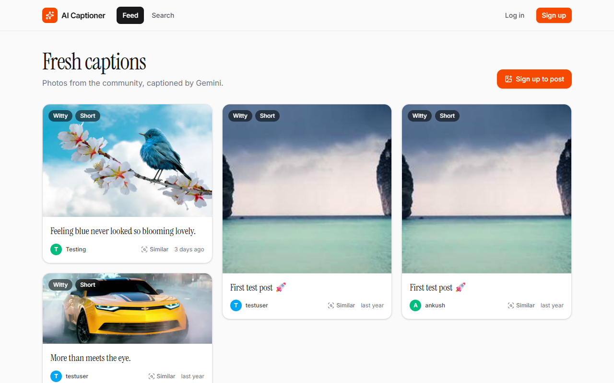
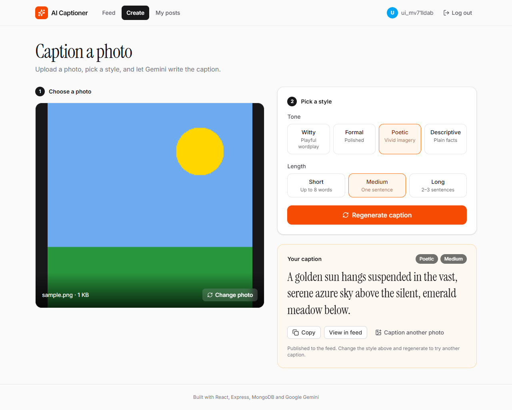
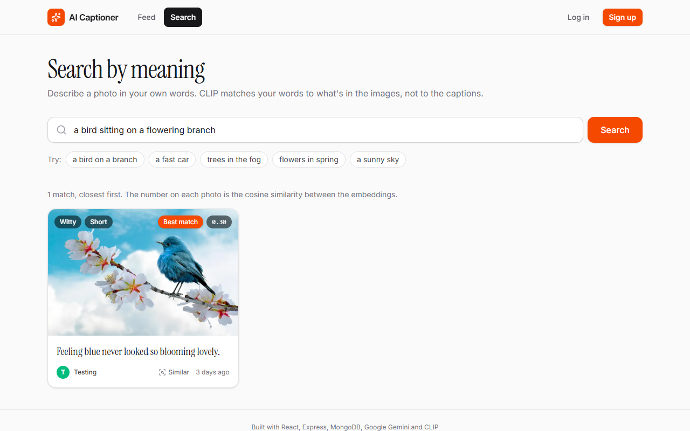
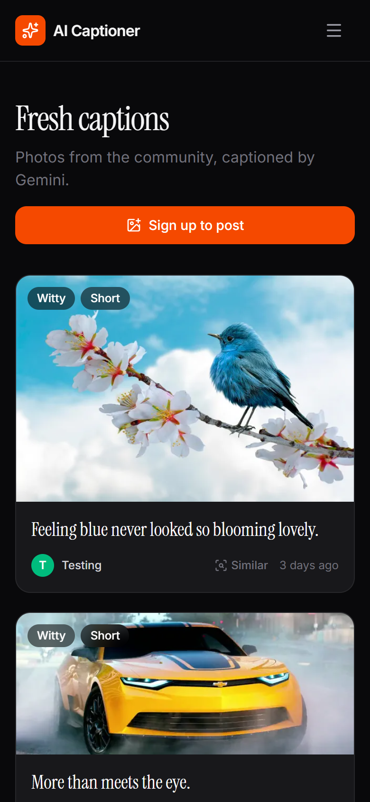
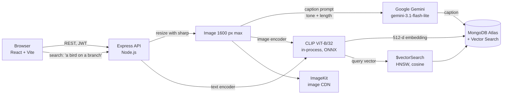

# AI Captioner

Upload a photo and get a caption in the style you choose (witty, formal, poetic or descriptive), then find
photos by describing them in your own words. A full-stack app with a built-in ML evaluation: Google Gemini
writes the captions, CLIP embeddings power semantic search, and a benchmark on COCO compares Gemini with
a dedicated captioning model (BLIP) using standard metrics.

**Live demo:** https://ai-captioner-tau.vercel.app
(The API runs on a free server that sleeps when idle, so the first request can take up to a minute.)



## Features

- **Captions in four tones and three lengths**, generated by Gemini; regenerate any caption in a new style.
- **Search by meaning, not keywords.** "A bird sitting on a flowering branch" finds the right photo even if
  its caption never mentions a bird, because the query is compared with the *image*, not the text.
- **"Similar" posts**: image-to-image search on any post.
- **Accounts**: sign up, log in, manage and delete your posts or your account.
- **A measured comparison of two captioning models** on 149 COCO images, with confidence intervals
  (see [Benchmark](#benchmark-gemini-vs-blip)).

| Create | Semantic search | Mobile (dark) |
|---|---|---|
|  |  |  |

## How it works



**Upload.** The image is downscaled (max 1600 px, EXIF orientation applied, metadata such as GPS location
removed). Gemini writes the caption while CLIP computes the image embedding in parallel; then the image goes
to ImageKit and the post (caption, style, 512-number embedding) is saved in MongoDB.

**Search.** CLIP was trained on 400 million image–text pairs so that an image and a sentence describing it
land close together in the same 512-dimensional space. The search query is encoded with CLIP's text encoder,
and MongoDB Atlas Vector Search finds the nearest image embeddings by cosine similarity, using an
approximate nearest-neighbour index (HNSW) instead of comparing against every post. Matches below a cosine
of 0.2 are treated as noise and dropped.

**Why CLIP runs inside the API.** Using an 8-bit quantized ONNX build through Transformers.js keeps the whole
backend in one Node.js service with no Python server: the model is ~150 MB instead of ~600 MB, embeds an
image in about half a second on a CPU, and fits in a 512 MB free instance.

## Tech stack

| Layer | Technology |
|---|---|
| Frontend | React 19, Vite, Tailwind CSS 4, React Router |
| Backend | Node.js, Express 5, Mongoose 8, JWT (bcryptjs), Multer, sharp |
| AI | Google Gemini (`@google/genai`), CLIP ViT-B/32 via `@huggingface/transformers` (ONNX, q8) |
| Data | MongoDB Atlas with Vector Search, ImageKit |
| Benchmark | Python, PyTorch, Hugging Face Transformers (BLIP, CLIP), pycocoevalcap, NLTK |
| Testing | Postman CLI (52 requests, 65 assertions) |
| Hosting | Vercel (frontend), Render (API), MongoDB Atlas M0 |

## Benchmark: Gemini vs BLIP

A general-purpose multimodal LLM against a model built for captioning, on 149 randomly sampled COCO
val2017 images (seed 42), each with 5 human reference captions. Full method, caveats and per-image results
in [`benchmark/`](benchmark/README.md).

| Model | BLEU-4 | METEOR | CIDEr | CLIPScore | Avg. words | Median latency |
|---|---|---|---|---|---|---|
| Gemini (`gemini-3.1-flash-lite`) | 0.131 | 0.494 | 0.386 | **34.01** | 18.8 | 2.49 s (API) |
| BLIP (`blip-image-captioning-base`) | **0.348** | 0.497 | **1.213** | 29.40 | 8.4 | **0.24 s** (T4 GPU) |
| *Human (1 reference vs the other 4)* | 0.217 | 0.469 | 1.020 | n/a | 10.4 | n/a |

- **BLIP wins the reference-based metrics** (CIDEr 3× higher, 95% CI of the difference −0.97 to −0.69).
  It was fine-tuned on COCO, so it reproduces the annotators' consensus phrasing, which is what CIDEr rewards.
  It even beats the human baseline on CIDEr.
- **Gemini wins the reference-free CLIPScore on 93% of images** (+4.6, CI +4.0 to +5.2): its captions
  describe more of what is actually in the photo, but they are twice as long as the references, which costs
  n-gram precision. METEOR shows no significant difference.
- **Takeaway:** which model "wins" depends on what the metric measures. Gemini suits this app (styled,
  detailed captions that follow instructions); BLIP would make a fast, free fallback when the API is busy.

The scoring pipeline checks itself: a held-out human caption is scored against the other references before
any result is reported. This check caught a silent bug in the standard COCO toolkit's Java tokenizer on
Colab, which had paired captions with the wrong images (BLIP CIDEr 0.06 instead of ~1.2).

## API

Base URL: `https://ai-captioner-api.onrender.com`. Endpoints marked 🔒 need `Authorization: Bearer <token>`.

| Method | Endpoint | Description |
|---|---|---|
| `GET` | `/api/health` | Health check |
| `POST` | `/api/users/register` | Create an account: `{ username, email, password }` |
| `POST` | `/api/users/login` | Returns `{ token, user }` |
| `DELETE` | `/api/users/me` 🔒 | Delete your account and all your posts |
| `GET` | `/api/posts` | Public feed, newest first |
| `GET` | `/api/posts/me` 🔒 | Your posts |
| `POST` | `/api/posts` 🔒 | Multipart form: `image` (JPEG/PNG/WebP, ≤ 5 MB), optional `tone` (`witty` \| `formal` \| `poetic` \| `descriptive`) and `length` (`short` \| `medium` \| `long`) |
| `POST` | `/api/posts/:id/regenerate` 🔒 | New caption for your post; optional `{ tone, length }` |
| `DELETE` | `/api/posts/:id` 🔒 | Delete your post |
| `GET` | `/api/posts/search?q=…&limit=12` | Text-to-image semantic search; each result has a `score` |
| `GET` | `/api/posts/:id/similar` | Posts with the most similar images |

Errors return `{ "message": "…" }` with a 4xx/5xx status (for example 413 for an image over 5 MB, 503 when
Gemini is overloaded).

## Run it locally

**Requirements:** Node.js 20+, a MongoDB Atlas cluster (the free M0 tier supports Vector Search), a Gemini
API key from Google AI Studio, and an ImageKit account.

```bash
git clone https://github.com/stash-724/ai-captioner.git
cd ai-captioner

# Backend
cd ai-captioner-backend
cp .env.example .env          # fill in your keys
npm install
npm run models:prefetch       # downloads CLIP (~150 MB) once
npm run search:index          # creates the Atlas Vector Search index (once per cluster)
npm run dev                   # http://localhost:5000

# Frontend (second terminal)
cd ai-captioner-frontend
npm install
npm run dev                   # http://localhost:5173 (proxies /api to the backend)
```

Useful scripts in the backend:

| Command | What it does |
|---|---|
| `npm run test:api` | Runs the Postman collection (auth, validation, upload limits, captions, search, ownership checks) with Postman CLI |
| `npm run search:backfill` | Computes CLIP embeddings for posts created before search existed |

## Deployment

- **Frontend → Vercel:** root directory `ai-captioner-frontend`, environment variable `VITE_API_URL` set to the API URL.
- **API → Render:** defined in [`render.yaml`](render.yaml). The build downloads the CLIP models
  (`npm run models:prefetch`), so a cold start loads them from disk in ~1 s instead of downloading them again.
  Set `CORS_ORIGIN` to the Vercel URL.
- **Database → MongoDB Atlas M0**, with network access open to the API host.

## Project structure

```
ai-captioner/
├── ai-captioner-backend/     Express API
│   ├── src/
│   │   ├── controllers/      Route handlers (users, posts, search)
│   │   ├── services/         Gemini, CLIP embeddings, vector search, image resizing, ImageKit
│   │   ├── middlewares/      JWT auth, upload limits, error handling
│   │   ├── models/           Mongoose schemas
│   │   └── routes/
│   ├── scripts/              Vector index, embedding backfill, model prefetch
│   └── tests/                Postman collection and fixture generator
├── ai-captioner-frontend/    React app
├── benchmark/                Colab notebook, rescoring script and results
└── render.yaml               Render deployment config
```

## Roadmap

- Sign in with Google, and email verification by one-time code
- One free caption without an account, then sign-up
- Private or public visibility for each post
